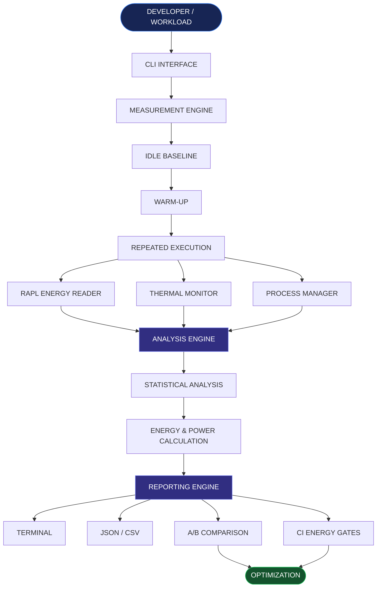

<div align="center">

# 8DoTs

### THE ENERGY LAYER FOR SOFTWARE ENGINEERING.

**Your code has a performance cost. It also has an energy cost.**

Measure what traditional profilers overlook.

<br/>

[](https://python.org)
[](https://kernel.org)
[](#)
[](LICENSE)

<br/>

**MEASURE → ANALYZE → COMPARE → OPTIMIZE**

</div>

---

## ◈ The idea behind 8DoTs

> What if we could measure software quality not only by how fast code runs, but also by how much energy it consumes?

Developers already measure execution time, CPU usage and memory consumption. But energy consumption often remains invisible.

Two programs can complete the same task in the same amount of time while consuming different amounts of energy.

**8DoTs makes that hidden cost measurable.**

It is a Linux-based software energy profiling toolkit that uses hardware energy counters, controlled workload execution, thermal monitoring and statistical analysis to help developers understand the energy behaviour of their applications.

---

## ◈ The problem we wanted to solve

| The overlooked problem | What 8DoTs brings |
|---|---|
| Energy consumption is invisible | Hardware-based energy measurement |
| Fast code isn't always energy-efficient | Energy and execution-time analysis |
| Background activity distorts results | Idle baseline correction |
| Single measurements can mislead | Repeated runs and statistical confidence |
| Heat can affect performance | Thermal monitoring |
| Code changes can increase energy usage | A/B comparison and CI energy gates |
| Uncontrolled workloads waste resources | Timeouts and process cleanup |

**The bigger goal:** Bring energy awareness into everyday software development.

---

## ◈ Inside the architecture

The journey of a workload through 8DoTs:



### How the system thinks

| Layer | What happens |
|---|---|
| 01 — Interface | Developer submits a workload through the CLI |
| 02 — Preparation | System checks hardware and captures idle baseline |
| 03 — Execution | Workload is warmed up and executed repeatedly |
| 04 — Observation | Energy counters, thermal data and process information are collected |
| 05 — Intelligence | Energy calculations and statistical analysis are performed |
| 06 — Decisions | Results are compared, exported and evaluated for regressions |

---

## ◈ The modules that power it

<details>
<summary><strong>01 / Energy Measurement Engine</strong></summary>

Reads RAPL/Powercap hardware energy counters.

- Energy counter discovery
- Energy delta calculation
- Counter wraparound handling
- Joule-based measurements

</details>

<details>
<summary><strong>02 / Baseline Engine</strong></summary>

Measures idle energy to account for background system consumption.

- Idle energy measurement
- Baseline correction
- More meaningful workload estimates

</details>

<details>
<summary><strong>03 / Execution Engine</strong></summary>

Controls how workloads are executed.

- Warm-up execution
- Repeated measurements
- Timeout handling
- Process isolation
- Child-process cleanup

</details>

<details>
<summary><strong>04 / Thermal Intelligence</strong></summary>

Observes the thermal behaviour of the system.

- CPU temperature readings
- Baseline and peak temperature
- Temperature variation
- Possible thermal throttling indicators

</details>

<details>
<summary><strong>05 / Statistical Engine</strong></summary>

Evaluates how consistent the measurements are.

- Mean energy
- Standard deviation
- Coefficient of Variation
- Confidence classification

</details>

<details>
<summary><strong>06 / Comparison & CI Engine</strong></summary>

Helps developers identify energy regressions.

- Before/after comparison
- Baseline storage
- Energy regression thresholds
- CI energy gates

</details>

<details>
<summary><strong>07 / Reporting Engine</strong></summary>

Transforms raw measurements into understandable results.

- Terminal reports
- JSON exports
- CSV exports
- Optional cost and carbon estimates

</details>

---

## ◈ From code to energy intelligence

A typical 8DoTs workflow:

```text
   YOUR CODE
       |
       v
   SYSTEM CHECK
       |
       v
   IDLE BASELINE
       |
       v
   WARM-UP
       |
       v
   REPEATED EXECUTION
       |
       v
   ENERGY + THERMAL DATA
       |
       v
   STATISTICAL ANALYSIS
       |
       v
   FINAL ENERGY REPORT
       |
       v
   OPTIMIZE YOUR CODE
```

---

## ◈ Get started

### Requirements

- Linux-based bare-metal machine
- Python 3.9+
- Supported RAPL/Powercap hardware interface
- Appropriate hardware-counter permissions

### Installation

```bash
git clone https://github.com/vikas468368-star/8DoTs.git

cd 8DoTs

python3 -m venv .venv

source .venv/bin/activate

python -m pip install --upgrade pip

python -m pip install -e ".[test]"
```

### Check your system

```bash
python -m dol8.cli doctor
```

### Profile a workload

```bash
python -m dol8.cli run workload.py --runs 5
```

### Compare implementations

```bash
python -m dol8.cli compare before.py after.py --runs 5
```

### Export a report

```bash
python -m dol8.cli run workload.py --runs 5 --json results.json
```

### Run tests

```bash
python -m pytest
```

---

## ◈ What does an energy report tell us?

An illustrative report:

```text
╔══════════════════════════════════════╗
║           8DoTs REPORT               ║
╠══════════════════════════════════════╣
║ Workload       : workload.py         ║
║ Execution Time : 2.099 seconds       ║
║ Energy         : 12.292 Joules       ║
║ Average Power  : 5.857 Watts         ║
║ Peak Power     : 18.960 Watts        ║
╠══════════════════════════════════════╣
║ Thermal Analysis                     ║
║ Baseline       : 60.3 C              ║
║ Peak           : 60.6 C              ║
╠══════════════════════════════════════╣
║ Measurement Confidence                ║
║ Runs           : 3                   ║
║ CoV            : 1.36%               ║
║ Confidence     : HIGH                ║
╚══════════════════════════════════════╝
```

*Illustrative values, not a benchmark guarantee.*

---

## ◈ Built with

<div align="center">

| TECHNOLOGY | ROLE |
|:---:|---|
| Python | Core profiling engine |
| Linux | System-level measurements |
| RAPL / Powercap | Hardware energy counters |
| psutil | Process monitoring |
| pytest | Testing and verification |
| JSON / CSV | Data and reporting |

</div>

---

## ◈ Engineering principles

**Accuracy over assumptions**

Hardware measurements and statistical confidence matter more than impressive-looking numbers.

**Transparency over misleading claims**

RAPL measures hardware energy domains, not exact per-process energy.

**Repeatability over one-time results**

Controlled execution and repeated measurements help reduce noise.

**Sustainability alongside performance**

Energy efficiency deserves a place in software quality engineering.

---

## ◈ Known limitations

- Hardware energy measurement requires supported RAPL/Powercap interfaces.
- Background processes can affect measurements.
- Hardware-level energy readings are not exact process-level attribution.
- Thermal behaviour depends on hardware and environmental conditions.
- Reliable comparisons should use consistent hardware and operating conditions.

---

## ◈ What's next?

Our potential development roadmap:

- [ ] Enhanced GPU and accelerator energy support
- [ ] Advanced visualization dashboard
- [ ] Improved real-time energy monitoring
- [ ] More detailed resource-to-energy correlation
- [ ] Extended CI/CD integrations
- [ ] Broader hardware compatibility
- [ ] More advanced energy regression analysis

---

## ◈ Why it matters

The future of software engineering is not only about building faster applications.

It is also about building applications that use resources responsibly.

8DoTs explores how energy measurement can become a practical part of the software development lifecycle.

**Because performance should not be measured in seconds alone.**

---

<div align="center">

# 8DoTs

### MEASURE BEYOND TIME.

**BUILD BEYOND PERFORMANCE.**

[GitHub Repository](https://github.com/vikas468368-star/8DoTs)

<br/>

*An open-source exploration of energy-aware and sustainable software engineering.*

</div>
