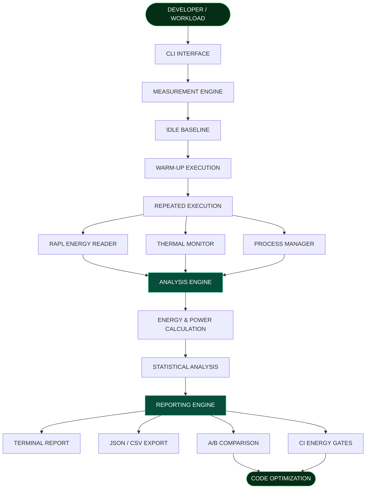

<div align="center">


<br/>

# 8DoTs

### THE ENERGY LAYER FOR SOFTWARE ENGINEERING

**Measure Beyond Time. Build Beyond Performance.**

[](https://python.org)
[](https://kernel.org)
[](#)
[](LICENSE)

**MEASURE → ANALYZE → COMPARE → OPTIMIZE**

</div>

---

## 01. The Vision

### What if we measured software quality beyond execution time?

Modern software development focuses heavily on speed, CPU utilization and memory consumption. But there is another important factor that often goes unnoticed:

**Energy Consumption.**

Two programs can perform the same task in similar execution times while consuming significantly different amounts of energy.

Traditional profiling tools do not always reveal this difference.

**8DoTs** is a Linux-based software energy profiling toolkit designed to make software energy consumption measurable, understandable and actionable.

Our mission is to bring energy awareness into everyday software engineering.

---

## 02. The Problem We Solve

| Engineering Challenge | 8DoTs Approach |
|---|---|
| Invisible energy consumption | Hardware-based energy measurement |
| Misleading performance comparisons | Energy and execution-time analysis |
| Background system noise | Idle baseline correction |
| Unreliable single-run results | Repeated execution and statistical analysis |
| CPU thermal behaviour | Thermal monitoring |
| Uncontrolled workloads | Timeout and process cleanup |
| Energy regressions | A/B comparison and CI energy gates |
| Difficult environmental impact estimation | Optional electricity and CO₂ estimation |

> We believe software should not only be fast. It should also be energy-efficient.

---

## 03. System Architecture

The complete journey from workload execution to actionable energy insights.



### Architecture Breakdown

| Layer | Responsibility |
|---|---|
| CLI Layer | Accepts profiling commands and parameters |
| Measurement Engine | Controls workload execution |
| Energy Reader | Collects RAPL/Powercap readings |
| Thermal Monitor | Observes CPU temperature |
| Process Manager | Handles timeouts and cleanup |
| Analysis Engine | Calculates energy and power |
| Statistical Engine | Evaluates measurement reliability |
| Comparison Engine | Compares implementations |
| CI Engine | Detects energy regressions |
| Reporting Engine | Generates structured reports |

---

## 04. The Technology Behind 8DoTs

<details>
<summary><strong>01 — Energy Measurement Engine</strong></summary>

Uses Linux RAPL/Powercap interfaces to collect hardware energy readings.

- Energy counter discovery
- Energy delta calculation
- Counter wraparound handling
- Joule-based measurement

</details>

<details>
<summary><strong>02 — Baseline Correction Engine</strong></summary>

Measures idle energy before workload execution to account for background system consumption.

- Idle energy measurement
- Baseline correction
- Workload energy estimation

</details>

<details>
<summary><strong>03 — Workload Execution Engine</strong></summary>

Provides controlled execution of software workloads.

- Warm-up execution
- Repeated execution
- Timeout handling
- Process isolation
- Child-process cleanup

</details>

<details>
<summary><strong>04 — Thermal Intelligence Engine</strong></summary>

Collects CPU thermal information to understand system behaviour.

- Baseline temperature
- Average temperature
- Peak temperature
- Temperature variation
- Possible thermal throttling indicators

</details>

<details>
<summary><strong>05 — Statistical Analysis Engine</strong></summary>

Evaluates the reliability and consistency of measurements.

- Mean energy consumption
- Standard deviation
- Coefficient of Variation (CoV)
- Confidence classification

</details>

<details>
<summary><strong>06 — Comparison & CI Engine</strong></summary>

Helps developers identify energy regressions between implementations.

- Before/after comparison
- Baseline storage
- Regression thresholds
- CI energy gates

</details>

<details>
<summary><strong>07 — Reporting Engine</strong></summary>

Transforms collected measurements into understandable reports.

- Terminal reports
- JSON exports
- CSV exports
- Optional electricity-cost estimates
- Optional carbon-impact estimates

</details>

---

## 05. Key Features

<div align="center">

| FEATURE | CAPABILITY |
|:---:|---|
| ⚡ | Hardware Energy Measurement |
| 📊 | Statistical Confidence Analysis |
| 🌡️ | CPU Thermal Monitoring |
| 🔬 | Idle Baseline Correction |
| 🔄 | Repeated Workload Execution |
| ⚖️ | A/B Implementation Comparison |
| 🛡️ | Process Timeout & Cleanup |
| 🚦 | CI Energy Regression Gates |
| 📁 | JSON & CSV Reporting |
| 🌱 | Optional Cost & Carbon Estimation |

</div>

---

## 06. Inside an Energy Report

An illustrative example of the information generated by 8DoTs:

```text
╔══════════════════════════════════════╗
║             8DoTs REPORT             ║
╠══════════════════════════════════════╣
║ Workload       : workload.py         ║
║ Execution Time : 2.099 seconds       ║
║ Energy         : 12.292 Joules       ║
║ Average Power  : 5.857 Watts         ║
║ Peak Power     : 18.960 Watts        ║
╠══════════════════════════════════════╣
║ THERMAL ANALYSIS                     ║
║ Baseline       : 60.3 C              ║
║ Peak           : 60.6 C              ║
║                                      ║
║ MEASUREMENT CONFIDENCE               ║
║ Runs           : 3                   ║
║ CoV            : 1.36%               ║
║ Confidence     : HIGH                ║
╚══════════════════════════════════════╝
```

*Illustrative values only, not actual benchmark results.*

---

## 07. Technology Stack

<div align="center">

| TECHNOLOGY | PURPOSE |
|:---:|---|
| Python | Core profiling engine |
| Linux | Hardware measurement environment |
| RAPL / Powercap | Hardware energy counters |
| Linux Thermal Interfaces | Temperature monitoring |
| psutil | Process and system information |
| pytest | Automated testing |
| JSON | Structured reporting |
| CSV | Measurement data export |

</div>

---

## 08. Get Started

### System Requirements

- Linux-based bare-metal machine.
- Python 3.9 or higher.
- Supported Intel or AMD hardware exposing RAPL/Powercap interfaces.
- Appropriate permissions for hardware energy counter access.

### Installation

**Step 1 — Clone the repository**

```bash
git clone https://github.com/vikas468368-star/8DoTs.git

cd 8DoTs
```

**Step 2 — Create a virtual environment**

```bash
python3 -m venv .venv

source .venv/bin/activate
```

**Step 3 — Install dependencies**

```bash
python -m pip install --upgrade pip

python -m pip install -e ".[test]"
```

**Step 4 — Check system readiness**

```bash
python -m dol8.cli doctor
```

### Start Profiling

```bash
python -m dol8.cli run workload.py --runs 5
```

### Compare Implementations

```bash
python -m dol8.cli compare before.py after.py --runs 5
```

### Export Results

```bash
python -m dol8.cli run workload.py --runs 5 --json results.json
```

### Run Tests

```bash
python -m pytest
```

---

## 09. Engineering Principles

**Accuracy over assumptions**

We prioritize hardware measurements and statistical reliability.

**Transparency over misleading claims**

Hardware energy measurements are not presented as exact per-process energy attribution.

**Repeatability over single-run results**

Repeated executions help identify measurement variability.

**Sustainability alongside performance**

Energy efficiency deserves to be considered a part of software quality.

---

## 10. Known Limitations

- Hardware energy measurement requires supported RAPL/Powercap interfaces.
- Background processes may influence measurements.
- Hardware-domain energy readings are not exact individual-process attribution.
- Thermal measurements depend on hardware and environmental conditions.
- Reliable comparisons require consistent hardware and execution conditions.
- Virtualized environments may not expose physical energy counters.

---

## 11. Future Roadmap

Our potential development directions:

- [ ] Enhanced GPU and accelerator energy measurement
- [ ] Advanced energy visualization dashboard
- [ ] Real-time energy monitoring
- [ ] Improved resource-to-energy correlation
- [ ] Extended CI/CD integrations
- [ ] Broader hardware compatibility
- [ ] Advanced energy regression analytics

---

## 12. Why 8DoTs Matters

The future of software engineering is not only about building faster applications.

It is about building applications that use computational resources responsibly.

8DoTs explores how energy measurement can become a practical part of the software development lifecycle.

**Our vision is to make energy efficiency measurable, understandable and actionable.**

---

## 13. Contributing

We welcome contributions, ideas and improvements.

1. Fork the repository.
2. Create a feature branch.
3. Implement your changes.
4. Add or update tests.
5. Run the test suite.
6. Submit a pull request.

```bash
python -m pytest
```

---

## 14. License

This project is distributed under the MIT License.

See [LICENSE](LICENSE) for details.

---

## 15. Acknowledgements

This repository is a fork of the original project:

[uyg7x/8DoTs](https://github.com/uyg7x/8DoTs)

Credit for upstream work belongs to the original project and its contributors.

---

<div align="center">


# 8DoTs

### MEASURE BEYOND TIME.

### BUILD BEYOND PERFORMANCE.

**An exploration of energy-aware and sustainable software engineering.**

[Explore Repository](https://github.com/vikas468368-star/8DoTs)

</div>
