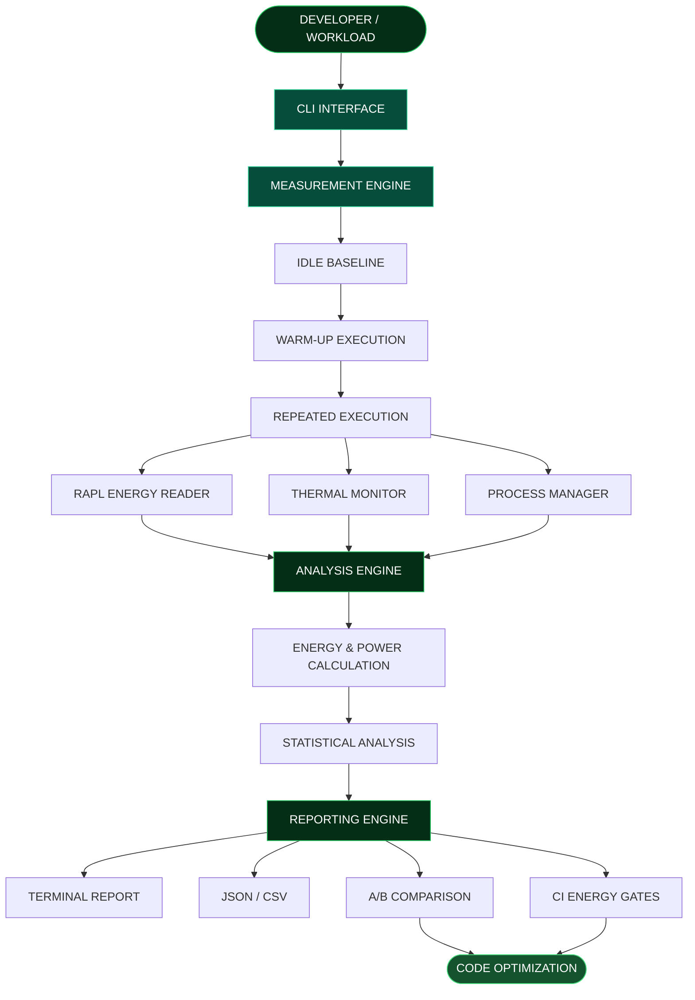

<div align="center">

# ⚡ 8DoTs

### SOFTWARE ENERGY PROFILING & INTELLIGENCE

**Measure Beyond Time. Build Beyond Performance.**

<br/>


<br/>

`01 MEASURE` &nbsp; → &nbsp; `02 ANALYZE` &nbsp; → &nbsp; `03 COMPARE` &nbsp; → &nbsp; `04 OPTIMIZE`

<br/>

**━━━━━━━━━━━━━━━━━━━━━━━━━━━━━━━━━━━━━━━━━━━━**

*Making invisible software energy consumption visible.*

**━━━━━━━━━━━━━━━━━━━━━━━━━━━━━━━━━━━━━━━━━━━━**

</div>

## ◈ 01 — THE VISION

### What if software performance was measured beyond execution time?

Modern software development focuses on speed, CPU utilization and memory consumption. But there is another important factor that often remains overlooked:

**ENERGY CONSUMPTION.**

Two programs can perform the same task in similar execution times while consuming significantly different amounts of energy.

Traditional profiling tools do not always reveal this difference.

**8DoTs** is a Linux-based software energy profiling toolkit designed to measure, analyze and compare the energy consumption of software workloads.

Our mission is to make energy efficiency a measurable part of software engineering.

---

<div align="center">

## ⚡ ENERGY IS THE NEXT PERFORMANCE METRIC

`PERFORMANCE + ENERGY EFFICIENCY = BETTER SOFTWARE`

</div>

---

## ◈ 02 — THE PROBLEM WE SOLVE

| THE CHALLENGE | THE 8DoTs APPROACH |
|---|---|
| Invisible energy consumption | Hardware-based energy measurement |
| Misleading performance comparisons | Energy and execution-time analysis |
| Background system noise | Idle baseline correction |
| Unreliable single-run measurements | Repeated execution and statistics |
| CPU thermal behaviour | Thermal monitoring |
| Uncontrolled processes | Timeout and process cleanup |
| Energy regressions | A/B comparison and CI energy gates |
| Environmental impact estimation | Optional electricity-cost and CO₂ estimation |

> We believe software should not only be fast. It should also be energy-efficient.

---

## ◈ 03 — SYSTEM ARCHITECTURE

**From workload execution to actionable energy intelligence.**



### Architecture layers

| LAYER | RESPONSIBILITY |
|---|---|
| CLI Interface | Accepts profiling commands and parameters |
| Measurement Engine | Controls workload execution |
| Energy Reader | Collects RAPL/Powercap readings |
| Thermal Monitor | Observes CPU temperature |
| Process Manager | Handles timeouts and process cleanup |
| Analysis Engine | Calculates energy and power |
| Statistical Engine | Evaluates measurement reliability |
| Comparison Engine | Compares software implementations |
| CI Engine | Detects energy regressions |
| Reporting Engine | Generates structured reports |

---

## ◈ 04 — CORE MODULES

<details>
<summary><strong>⚡ 01 — ENERGY MEASUREMENT ENGINE</strong></summary>

Reads hardware energy counters through Linux RAPL/Powercap interfaces.

**Responsibilities**

- Energy counter discovery.
- Energy delta calculation.
- Counter wraparound handling.
- Joule-based measurements.

</details>

<details>
<summary><strong>◈ 02 — BASELINE CORRECTION ENGINE</strong></summary>

Measures idle energy before workload execution to account for background system consumption.

**Responsibilities**

- Idle energy measurement.
- Baseline correction.
- Workload energy estimation.

</details>

<details>
<summary><strong>◈ 03 — WORKLOAD EXECUTION ENGINE</strong></summary>

Provides controlled execution of software workloads.

**Responsibilities**

- Warm-up execution.
- Repeated workload execution.
- Timeout handling.
- Process isolation.
- Child-process cleanup.

</details>

<details>
<summary><strong>◈ 04 — THERMAL INTELLIGENCE ENGINE</strong></summary>

Collects CPU thermal information to understand system behaviour.

**Responsibilities**

- Baseline temperature.
- Average temperature.
- Peak temperature.
- Temperature variation.
- Possible thermal throttling indicators.

</details>

<details>
<summary><strong>◈ 05 — STATISTICAL ANALYSIS ENGINE</strong></summary>

Evaluates the reliability and consistency of energy measurements.

**Responsibilities**

- Mean energy consumption.
- Standard deviation.
- Coefficient of Variation.
- Confidence classification.

</details>

<details>
<summary><strong>◈ 06 — COMPARISON & CI ENGINE</strong></summary>

Helps developers identify energy regressions between software implementations.

**Responsibilities**

- Before/after comparison.
- Baseline storage.
- Regression thresholds.
- CI energy gates.

</details>

<details>
<summary><strong>◈ 07 — REPORTING ENGINE</strong></summary>

Transforms collected measurements into understandable reports.

**Responsibilities**

- Terminal reports.
- JSON exports.
- CSV exports.
- Optional electricity-cost estimation.
- Optional carbon-impact estimation.

</details>

---

## ◈ 05 — KEY CAPABILITIES

<div align="center">

| ⚡ ENERGY | 📊 ANALYSIS |
|:---:|:---:|
| Hardware energy measurement | Statistical confidence |
| Idle baseline correction | Repeated measurements |
| Power calculation | Measurement variability |

| 🌡️ MONITORING | 🚀 OPTIMIZATION |
|:---:|:---:|
| CPU thermal monitoring | A/B comparison |
| Throttling indicators | CI energy gates |
| Process management | Regression detection |

</div>

---

## ◈ 06 — INSIDE AN ENERGY REPORT

**An illustrative example of the information generated by 8DoTs.**

```text
╔══════════════════════════════════════════╗
║             ⚡ 8DoTs REPORT              ║
╠══════════════════════════════════════════╣
║ TARGET       : workload.py               ║
║ TIME         : 2.099 seconds             ║
║ ENERGY       : 12.292 Joules             ║
║ AVG POWER    : 5.857 Watts               ║
║ PEAK POWER   : 18.960 Watts              ║
╠══════════════════════════════════════════╣
║             THERMAL ANALYSIS             ║
║ BASELINE     : 60.3 C                    ║
║ PEAK         : 60.6 C                    ║
╠══════════════════════════════════════════╣
║          STATISTICAL CONFIDENCE           ║
║ RUNS         : 3                         ║
║ CoV          : 1.36%                     ║
║ CONFIDENCE   : HIGH                      ║
╚══════════════════════════════════════════╝
```

<sub>Illustrative values only, not actual benchmark results.</sub>

---

## ◈ 07 — TECHNOLOGY STACK

<div align="center">


</div>

| TECHNOLOGY | PURPOSE |
|---|---|
| Python | Core profiling engine |
| Linux | Hardware measurement environment |
| RAPL / Powercap | Hardware energy counters |
| Linux Thermal Interfaces | Temperature monitoring |
| psutil | Process and system information |
| pytest | Automated testing |
| JSON | Structured reporting |
| CSV | Measurement data export |

---

## ◈ 08 — GET STARTED

### SYSTEM REQUIREMENTS

- Linux-based bare-metal machine.
- Python 3.9 or higher.
- Supported Intel or AMD hardware exposing RAPL/Powercap interfaces.
- Appropriate permissions for hardware energy-counter access.

### 01 / CLONE REPOSITORY

```bash
git clone https://github.com/vikas468368-star/8DoTs.git

cd 8DoTs
```

### 02 / CREATE ENVIRONMENT

```bash
python3 -m venv .venv

source .venv/bin/activate
```

### 03 / INSTALL DEPENDENCIES

```bash
python -m pip install --upgrade pip

python -m pip install -e ".[test]"
```

### 04 / CHECK SYSTEM READINESS

```bash
python -m dol8.cli doctor
```

### 05 / START PROFILING

```bash
python -m dol8.cli run workload.py --runs 5
```

### 06 / COMPARE IMPLEMENTATIONS

```bash
python -m dol8.cli compare before.py after.py --runs 5
```

### 07 / EXPORT RESULTS

```bash
python -m dol8.cli run workload.py --runs 5 --json results.json
```

### 08 / RUN TESTS

```bash
python -m pytest
```

---

## ◈ 09 — ENGINEERING PRINCIPLES

<div align="center">

| PRINCIPLE | OUR APPROACH |
|:---:|---|
| ACCURACY | Hardware measurements over assumptions |
| TRANSPARENCY | Honest measurement limitations |
| REPEATABILITY | Multiple runs over single observations |
| SUSTAINABILITY | Energy efficiency alongside performance |

</div>

---

## ◈ 10 — KNOWN LIMITATIONS

- Requires supported RAPL/Powercap hardware interfaces.
- Background workloads can influence readings.
- Hardware-domain measurements are not exact individual-process energy attribution.
- Thermal behaviour depends on hardware and environmental conditions.
- Reliable comparisons require consistent measurement conditions.
- Virtualized environments may not expose physical energy counters.

---

## ◈ 11 — FUTURE ROADMAP

**THE NEXT GENERATION OF ENERGY-AWARE SOFTWARE ENGINEERING**

- [ ] Enhanced GPU and accelerator energy support.
- [ ] Advanced energy visualization dashboard.
- [ ] Real-time energy monitoring.
- [ ] Improved resource-to-energy correlation.
- [ ] Extended CI/CD integrations.
- [ ] Broader hardware compatibility.
- [ ] Advanced energy regression analytics.

---

## ◈ 12 — WHY 8DoTs MATTERS

The future of software engineering is not only about building faster applications.

It is about building applications that use computational resources responsibly.

8DoTs explores how energy measurement can become a practical part of the software development lifecycle.

**Our vision is to make energy efficiency measurable, understandable and actionable.**

---

## ◈ 13 — CONTRIBUTING

Contributions, ideas and improvements are welcome.

1. Fork this repository.
2. Create a feature branch.
3. Implement your changes.
4. Add or update tests.
5. Submit a pull request.

---

## ◈ 14 — LICENSE & ACKNOWLEDGEMENTS

Distributed under the MIT License. See [LICENSE](LICENSE).

This repository is a fork of the original project:

[uyg7x/8DoTs](https://github.com/uyg7x/8DoTs)

Credit for upstream work belongs to the original project and its contributors.

---

<div align="center">

**━━━━━━━━━━━━━━━━━━━━━━━━━━━━━━━━━━━━━━━━━━━━**

# ⚡ 8DoTs

### MEASURE BEYOND TIME.

### BUILD BEYOND PERFORMANCE.

<br/>

`ENERGY AWARENESS` &nbsp; · &nbsp; `ENGINEERING INTELLIGENCE` &nbsp; · &nbsp; `SUSTAINABLE SOFTWARE`

<br/>

[**EXPLORE THE REPOSITORY →**](https://github.com/vikas468368-star/8DoTs)

**━━━━━━━━━━━━━━━━━━━━━━━━━━━━━━━━━━━━━━━━━━━━**

</div>
