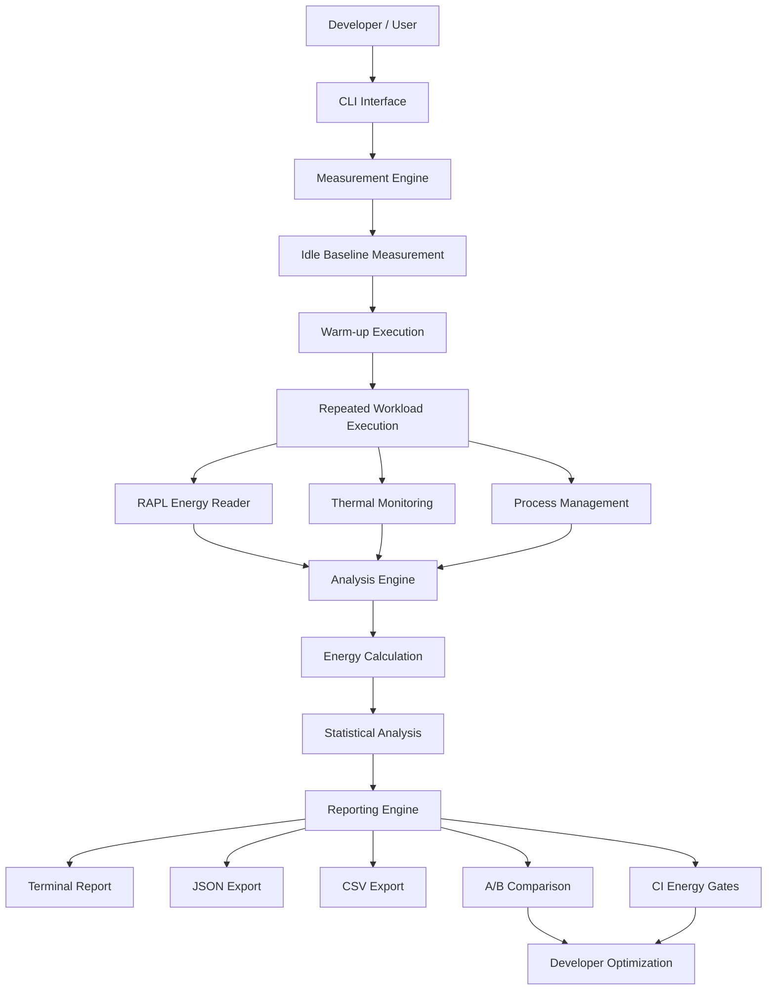

# 8DoTs — Software Energy Profiling & Optimization

<p align="center">
  <strong>Measure Beyond Time. Build Beyond Performance.</strong>
  <br />
  A Linux-based software energy profiling toolkit.
</p>

<p align="center">
  
  
  
  
</p>

---

## 1. Introduction

**8DoTs** (internally structured as the `dol8` Python package) is a Linux command-line tool designed to measure, analyze, and compare the energy consumption of software workloads.

Traditional software profiling focuses primarily on execution time, CPU utilization, and memory consumption. However, these metrics do not necessarily reveal how much electrical energy an application consumes.

8DoTs addresses this gap by using hardware energy counters (RAPL/Powercap) and Linux thermal interfaces to produce repeatable, high-resolution estimates of software energy consumption.

The project aims to make energy efficiency a measurable part of software development.

**Our objective:**

Help developers understand not only how fast their software runs, but also how much energy it consumes and whether it behaves efficiently under execution.

---

## 2. The Problem That Inspired 8DoTs

Modern software development has traditionally prioritized performance.

Developers optimize applications to:
- Reduce execution time.
- Minimize memory consumption.
- Improve CPU utilization.
- Increase application responsiveness.

However, an important question often remains unanswered:

**How much energy does the software consume to perform its work?**

This creates several problems.

### Problem 1: Invisible Energy Consumption

Two programs can have identical execution times but significantly different energy consumption.

Traditional performance profiling does not necessarily reveal this difference.

**Our approach:** Measure hardware energy consumption using RAPL counters.

### Problem 2: Silent Thermal Throttling

When processors become too hot, they may reduce their operating frequency to control temperature.

This can cause unexpected performance degradation.

**Our approach:** Monitor CPU thermal information and report possible thermal throttling events.

### Problem 3: Unreliable Measurements

A single execution can produce misleading results because of:
- Background processes.
- CPU frequency variations.
- Cache behavior.
- System noise.
- Hardware counter quantization.

**Our approach:** Use repeated executions and statistical analysis to evaluate measurement consistency.

### Problem 4: Runaway Processes

A workload may run indefinitely or create child processes that continue running after a timeout.

This wastes resources and can affect subsequent measurements.

**Our approach:** Use process-group isolation, timeout handling, and process-tree cleanup.

### Problem 5: Energy Regressions After Code Changes

A new code implementation may perform the same task while consuming more energy.

Traditional testing may not detect this regression.

**Our approach:** Compare implementations and use CI energy gates to identify significant energy increases.

---

## 3. Our Solution

8DoTs introduces an energy-aware software profiling workflow.

It combines:

1. Hardware-based energy measurement.
2. Idle energy baseline correction.
3. Controlled workload execution.
4. CPU thermal monitoring.
5. Statistical confidence analysis.
6. Energy and power calculations.
7. A/B implementation comparison.
8. Automated CI energy regression checks.
9. JSON and CSV reporting.
10. Optional electricity cost and carbon-impact estimation.

Instead of treating execution time as the only indicator of software performance, 8DoTs introduces energy consumption as another important measurement.

---

## 4. System Architecture



### Architecture Explanation

| Layer | Responsibility |
|---|---|
| CLI Interface | Accepts user commands and profiling parameters. |
| Measurement Engine | Controls baseline, warm-up, and repeated executions. |
| RAPL Reader | Reads hardware energy counters through Linux Powercap. |
| Thermal Monitor | Collects CPU temperature information. |
| Process Manager | Handles execution, timeouts, and process cleanup. |
| Analysis Engine | Calculates energy consumption and power. |
| Statistical Engine | Evaluates measurement consistency. |
| Comparison Engine | Compares different implementations. |
| CI Energy Gate | Detects energy regressions against saved baselines. |
| Reporting Engine | Produces terminal, JSON, and CSV reports. |

---

## 5. Core Modules

### 5.1 Energy Measurement Module

Uses Linux RAPL/Powercap interfaces to read hardware energy counters.

Responsibilities:
- Discover available energy domains.
- Read energy counter values.
- Calculate energy differences.
- Handle counter wraparound.
- Convert measurements into joules.

### 5.2 Baseline Measurement Module

Measures idle system energy before workload execution.

Its purpose is to account for background energy consumption during the measurement window.

### 5.3 Workload Execution Module

Executes the target program in a controlled environment.

Responsibilities:
- Sequential workload execution.
- Warm-up execution.
- Repeated measurements.
- Timeout handling.
- Process-group isolation.
- Child-process cleanup.

### 5.4 Thermal Monitoring Module

Reads CPU thermal information from Linux thermal interfaces.

Reports:
- Baseline temperature.
- Average temperature.
- Peak temperature.
- Ending temperature.
- Temperature rise.
- Heuristic thermal throttling indicators.

### 5.5 Statistical Analysis Module

Repeated measurements are analyzed to understand their reliability.

Metrics include:
- Mean energy consumption.
- Standard deviation.
- Coefficient of Variation (CoV).
- Measurement confidence classification.

Results are classified as HIGH, MEDIUM, or LOW confidence.

### 5.6 Comparison Module

Allows developers to compare two implementations using A/B measurements.

Example:

```bash
python -m dol8.cli compare before.py after.py --runs 5
```

This helps identify whether a code change improves or increases energy consumption.

### 5.7 CI Energy Gate Module

Allows energy regression checks in development workflows.

A saved baseline can be used to evaluate subsequent executions.

Example:

```bash
python -m dol8.cli gate save result.json --out baseline.json
```

Run a workload against the baseline:

```bash
python -m dol8.cli run new_workload.py \
  --runs 5 \
  --gate-baseline baseline.json \
  --threshold 15
```

The gate uses a noise guard and statistical significance checks before reporting a regression.

### 5.8 Reporting Module

Generates structured profiling reports.

Supported output formats:
- Terminal output.
- JSON.
- CSV time-series data.

Reports can also include optional electricity-cost and CO2 estimates.

---

## 6. How 8DoTs Works

The measurement workflow follows these stages:

**Stage 1 — System Readiness**

Checks hardware availability and access to required Linux interfaces.

**Stage 2 — Baseline Measurement**

Measures idle system energy before running the workload.

**Stage 3 — Warm-up**

Executes the workload once to reduce initial execution variability.

**Stage 4 — Repeated Execution**

Runs the workload sequentially for the requested number of repetitions.

**Stage 5 — Energy Collection**

Captures start and end hardware energy counter readings.

**Stage 6 — Calculation**

Calculates energy differences, applies idle baseline correction, and derives power metrics.

**Stage 7 — Statistical Analysis**

Evaluates measurement consistency using repeated observations.

**Stage 8 — Reporting**

Generates the final energy and thermal report.

---

## 7. Key Features

| Feature | Purpose |
|---|---|
| RAPL Energy Measurement | Hardware-based energy readings. |
| Counter Wraparound Correction | Handles hardware counter overflow. |
| Idle Baseline Correction | Accounts for background energy. |
| Thermal Monitoring | Provides CPU thermal context. |
| Statistical Confidence | Evaluates measurement reliability. |
| Process Isolation | Prevents uncontrolled workload execution. |
| Timeout Handling | Controls long-running workloads. |
| A/B Comparison | Compares implementation efficiency. |
| CI Energy Gates | Helps prevent energy regressions. |
| JSON Export | Enables structured analysis. |
| CSV Export | Enables time-series analysis. |
| Cost Estimation | Estimates electricity expenses. |
| CO2 Estimation | Estimates associated carbon impact. |

---

## 8. Technology Stack

| Technology | Purpose |
|---|---|
| Python | Core application implementation. |
| Linux | Hardware measurement environment. |
| RAPL / Powercap | Hardware energy counters. |
| Linux Thermal Interfaces | Temperature monitoring. |
| psutil | Process and system information. |
| pytest | Automated testing. |
| JSON | Structured report generation. |
| CSV | Measurement data export. |
| GitHub Actions / CI | Automated development workflows. |

---

## 9. Requirements

### Supported Environment

- Bare-metal Linux.
- Python 3.9 or higher.
- Intel or AMD hardware exposing supported RAPL counters through Linux Powercap.
- Appropriate permissions to access hardware energy counters.

### Unsupported Environments

- Windows hardware profiling.
- macOS hardware profiling.
- Virtual machines without exposed physical energy counters.
- WSL2 hardware energy profiling.

The automated test suite can still run in environments where hardware energy profiling is unavailable.

---

## 10. Installation

### Step 1 — Clone the Repository

```bash
git clone https://github.com/vikas468368-star/8DoTs.git

cd 8DoTs
```

### Step 2 — Create a Virtual Environment

```bash
python3 -m venv .venv

source .venv/bin/activate
```

### Step 3 — Upgrade pip

```bash
python -m pip install --upgrade pip
```

### Step 4 — Install Dependencies

```bash
python -m pip install -e ".[test]"
```

### Step 5 — Check System Readiness

```bash
python -m dol8.cli doctor
```

---

## 11. Usage

### Profile a Python Workload

```bash
python -m dol8.cli run workload.py --runs 5
```

### Execute With a Timeout

```bash
python -m dol8.cli run workload.py --timeout 120 --runs 3
```

### Export Results to JSON

```bash
python -m dol8.cli run workload.py \
  --runs 5 \
  --json results.json
```

### Compare Two Implementations

```bash
python -m dol8.cli compare before.py after.py --runs 5
```

### Save an Energy Baseline

```bash
python -m dol8.cli gate save result.json --out baseline.json
```

### Run Automated Tests

```bash
python -m pytest
```

---

## 12. Example Output

```text
===== DoL8 REPORT (HIGH-RESOLUTION ESTIMATE) =====

Target: workload.py

TIME: 2.099s (+- 0.044s)

ENERGY: 12.292 J

POWER:
  Average: 5.857 W
  Peak:    18.960 W

THERMAL:
  Baseline: 60.3 C
  Peak:     60.6 C
  Average:  60.2 C
  End:      60.5 C

THROTTLING: No

CONFIDENCE:
  Runs: 3
  Mean: 12.292 J
  CoV:  1.36%
  Level: HIGH
```

*Illustrative output from the project documentation.*

---

## 13. Limitations and Engineering Considerations

We believe transparent measurement is important.

### Hardware Dependency

RAPL availability depends on CPU architecture and Linux hardware interfaces.

**Consideration:** Use a supported bare-metal Linux system.

### Energy Attribution

RAPL measures energy at hardware domain level, not exact individual-process energy.

**Consideration:** Use a dedicated and relatively idle machine for more reliable estimates.

### System Noise

Background workloads can influence measurements.

**Consideration:** Use repeated executions and statistical confidence metrics.

### Environmental Variation

Cooling, ambient temperature, CPU frequency and hardware differences can influence results.

**Consideration:** Perform A/B comparisons on the same machine under consistent conditions.

---

## 14. Future Scope

Potential development directions include:

- Enhanced GPU and accelerator energy measurement.
- More detailed resource-to-energy correlation.
- Improved real-time monitoring.
- Enhanced visualization and analytics.
- Better support for additional hardware platforms.
- Expanded CI/CD integrations.
- More advanced energy regression analysis.
- Real-world energy optimization case studies.

---

## 15. Why 8DoTs Matters

8DoTs explores an important direction in modern software engineering: sustainable software development.

Software quality should not be evaluated only through execution speed or resource utilization.

Energy consumption is another important dimension.

By making energy measurements accessible to developers, 8DoTs encourages more informed engineering decisions and promotes energy-aware development practices.

**Our vision is simple: Make energy efficiency measurable, understandable, and actionable.**

---

## 16. Contributing

Contributions are welcome.

1. Fork the repository.
2. Create a feature branch.
3. Implement your changes.
4. Add or update tests.
5. Run the test suite.
6. Submit a pull request.

```bash
python -m pytest
```

Please include a clear description of the problem, implementation and verification steps.

---

## 17. License

This project is distributed under the MIT License.

See the [LICENSE](LICENSE) file for details.

---

## 18. Acknowledgements

8DoTs is maintained in this repository as a fork of the original project:

[uyg7x/8DoTs](https://github.com/uyg7x/8DoTs)

Credit for upstream work belongs to the original project and its contributors. Changes and additional contributions in this fork should be documented through the repository's commit history.

---

<p align="center">
  <strong>8DoTs</strong>
  <br />
  Measure Beyond Time. Build Beyond Performance.
</p>
