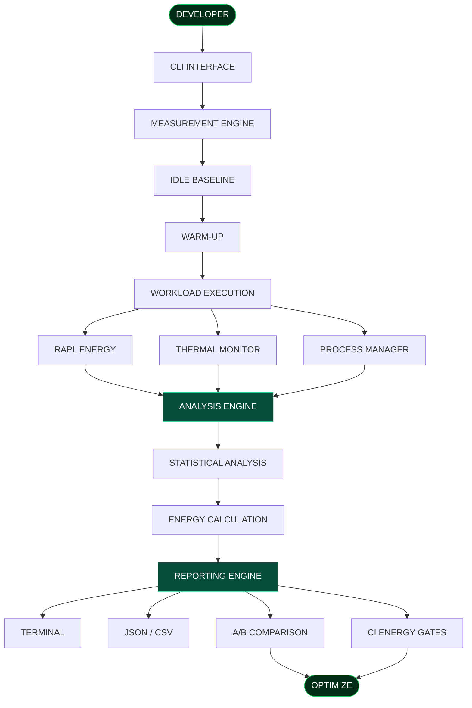

<div align="center">

# <span style="color:#39FF88;">8DoTs</span>

### THE ENERGY LAYER FOR SOFTWARE ENGINEERING

**Measure Beyond Time. Build Beyond Performance.**

<br/>


<br/><br/>

`MEASURE` &nbsp; → &nbsp; `ANALYZE` &nbsp; → &nbsp; `COMPARE` &nbsp; → &nbsp; `OPTIMIZE`

</div>

---

<div align="center">

## ◈ SOFTWARE HAS AN ENERGY COST

**Why measure only how fast code runs when we can measure how much energy it consumes?**

</div>

Traditional profiling focuses on execution time, CPU utilization and memory.

But performance is only one part of software efficiency.

8DoTs brings energy consumption into the picture through hardware-based energy measurement, thermal monitoring and statistical analysis.

---

## <span style="color:#00E676;">01 / THE PROBLEM</span>

| PROBLEM | OUR APPROACH |
|:---|:---|
| Invisible energy consumption | RAPL energy measurement |
| Misleading performance comparisons | Energy + execution-time analysis |
| Background system noise | Idle baseline correction |
| Unreliable single-run results | Repeated execution + statistics |
| CPU thermal behaviour | Thermal monitoring |
| Uncontrolled processes | Timeout + cleanup |
| Energy regressions | A/B comparison + CI gates |

<div align="center">

**THE GOAL: MAKE SOFTWARE ENERGY EFFICIENCY MEASURABLE.**

</div>

---

## <span style="color:#00E676;">02 / SYSTEM ARCHITECTURE</span>



---

## <span style="color:#00E676;">03 / CORE MODULES</span>

<details>
<summary><strong>⚡ 01 — Energy Measurement</strong></summary>

- RAPL/Powercap hardware counters
- Energy delta calculation
- Counter wraparound handling
- Joule-based measurements

</details>

<details>
<summary><strong>◈ 02 — Baseline Correction</strong></summary>

- Idle system energy measurement
- Background energy correction
- Workload energy estimation

</details>

<details>
<summary><strong>◈ 03 — Execution Management</strong></summary>

- Warm-up execution
- Repeated workload execution
- Timeout handling
- Process isolation
- Child-process cleanup

</details>

<details>
<summary><strong>◈ 04 — Thermal Intelligence</strong></summary>

- CPU temperature monitoring
- Baseline and peak temperature
- Temperature variation
- Possible throttling indicators

</details>

<details>
<summary><strong>◈ 05 — Statistical Intelligence</strong></summary>

- Mean energy consumption
- Standard deviation
- Coefficient of Variation
- Confidence classification

</details>

<details>
<summary><strong>◈ 06 — Comparison & CI Engine</strong></summary>

- Before/after comparison
- Baseline storage
- Energy regression thresholds
- CI energy gates

</details>

<details>
<summary><strong>◈ 07 — Reporting Engine</strong></summary>

- Terminal reports
- JSON exports
- CSV exports
- Optional electricity cost and carbon estimates

</details>

---

## <span style="color:#00E676;">04 / KEY CAPABILITIES</span>

<div align="center">

| ⚡ ENERGY | 📊 ANALYSIS |
|:---:|:---:|
| Hardware measurement | Statistical confidence |
| Idle correction | Repeated measurements |
| Power calculation | Measurement variability |

| 🌡️ MONITORING | 🚀 OPTIMIZATION |
|:---:|:---:|
| CPU thermal data | A/B comparison |
| Throttling indicators | CI energy gates |
| Process management | Regression detection |

</div>

---

## <span style="color:#00E676;">05 / INSIDE THE REPORT</span>

```text
╔══════════════════════════════════════╗
║          8DoTs / ENERGY REPORT       ║
╠══════════════════════════════════════╣
║ TARGET       : workload.py           ║
║ TIME         : 2.099 seconds         ║
║ ENERGY       : 12.292 Joules         ║
║ AVG POWER    : 5.857 Watts           ║
║ PEAK POWER   : 18.960 Watts          ║
╠══════════════════════════════════════╣
║ THERMAL ANALYSIS                     ║
║ BASELINE     : 60.3 C                ║
║ PEAK         : 60.6 C                ║
╠══════════════════════════════════════╣
║ STATISTICAL CONFIDENCE               ║
║ RUNS         : 3                     ║
║ CoV          : 1.36%                 ║
║ CONFIDENCE   : HIGH                  ║
╚══════════════════════════════════════╝
```

<sub>Illustrative output, not actual benchmark results.</sub>

---

## <span style="color:#00E676;">06 / TECHNOLOGY STACK</span>

<div align="center">


</div>

| TECHNOLOGY | PURPOSE |
|:---|:---|
| Python | Core profiling engine |
| Linux | Hardware measurement |
| RAPL / Powercap | Energy counters |
| Linux Thermal Interfaces | Temperature monitoring |
| psutil | Process information |
| pytest | Automated testing |
| JSON / CSV | Data export |

---

## <span style="color:#00E676;">07 / GET STARTED</span>

**01 — Clone**

```bash
git clone https://github.com/vikas468368-star/8DoTs.git
cd 8DoTs
```

**02 — Environment**

```bash
python3 -m venv .venv
source .venv/bin/activate
```

**03 — Install**

```bash
python -m pip install --upgrade pip
python -m pip install -e ".[test]"
```

**04 — System Check**

```bash
python -m dol8.cli doctor
```

**05 — Start Profiling**

```bash
python -m dol8.cli run workload.py --runs 5
```

**06 — Compare Implementations**

```bash
python -m dol8.cli compare before.py after.py --runs 5
```

---

## <span style="color:#00E676;">08 / ENGINEERING PRINCIPLES</span>

| PRINCIPLE | MEANING |
|:---|:---|
| Accuracy | Hardware measurements over assumptions |
| Transparency | Honest measurement limitations |
| Repeatability | Multiple runs over single observations |
| Sustainability | Energy efficiency alongside performance |

---

## <span style="color:#00E676;">09 / FUTURE ROADMAP</span>

- [ ] GPU and accelerator energy support
- [ ] Advanced visualization dashboard
- [ ] Real-time energy monitoring
- [ ] Improved resource-to-energy correlation
- [ ] Extended CI/CD integrations
- [ ] Broader hardware compatibility
- [ ] Advanced energy regression analytics

---

## <span style="color:#00E676;">10 / LIMITATIONS</span>

- Requires supported RAPL/Powercap hardware interfaces.
- Background workloads can affect readings.
- Hardware-domain measurements are not exact per-process attribution.
- Thermal behaviour depends on hardware and environmental conditions.
- Reliable comparisons require consistent measurement conditions.

---

## <span style="color:#00E676;">11 / CONTRIBUTING</span>

Contributions and improvements are welcome.

1. Fork this repository.
2. Create a feature branch.
3. Implement your changes.
4. Add or update tests.
5. Submit a pull request.

---

## <span style="color:#00E676;">12 / LICENSE & ACKNOWLEDGEMENTS</span>

Distributed under the MIT License. See [LICENSE](LICENSE).

This repository is a fork of [uyg7x/8DoTs](https://github.com/uyg7x/8DoTs). Credit for upstream contributions belongs to the original project and its contributors.

---

<div align="center">

# <span style="color:#00E676;">8DoTs</span>

### MEASURE BEYOND TIME.

### BUILD BEYOND PERFORMANCE.

<br/>

`ENERGY AWARENESS. ENGINEERING INTELLIGENCE. SUSTAINABLE SOFTWARE.`

<br/>

[**VIEW REPOSITORY →**](https://github.com/vikas468368-star/8DoTs)

</div>
